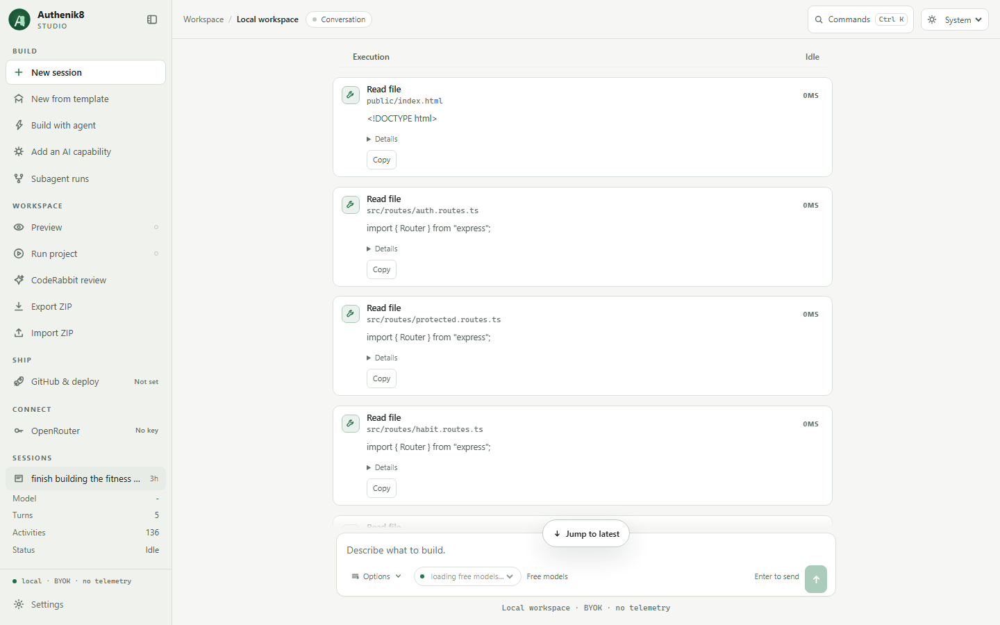

# Authenik8

**Build secure Express + TypeScript backends fast, without starting from insecure defaults.**

Authenik8 is an open-source toolkit for shipping identity-aware apps. It gives you a production-minded auth starter CLI, a local BYOK Studio for building and iterating on projects, and supporting packages for models, MCP tooling, design checks, and agent workflows.

> Vibe-code the interface. Keep identity on a backend you own.

## Studio preview



## Why Authenik8 exists

Most app starters make it easy to render a UI, but leave auth, sessions, ownership, and backend security as an exercise for later. Authenik8 exists to close that gap: help you move fast while keeping identity and project control on infrastructure you own.

## What you get

- **Secure auth starter CLI** : scaffold Express + TypeScript projects with JWT, refresh rotation, Redis, RBAC, OAuth, and Prisma options via `create-authenik8-app`.
- **Authenik8 Studio** : a localhost app builder with chat, live preview, sandboxed file tools, agent runs, export, and run workflows.
- **BYOK model access** : bring your own OpenRouter key; keys are sent per request and not stored by Studio.
- **Local-first workflow** : Studio binds to `127.0.0.1`, works on your machine, and keeps generated project files in a real local sandbox/folder.
- **Design and engineering guardrails** : reusable design tokens/checks and an engineering canon for safer changes.
- **Integration-ready** : Studio includes workflows for OpenCode agent runs, GitHub sync, Supabase settings, and static deploy targets like Vercel/Netlify where configured.

## Quick start

### 1) Generate an auth backend

Requires Node.js 20.19+, 22.12+, or >=24.

```bash
npx create-authenik8-app@latest my-app
cd my-app
npm install
npm run dev
```

Follow the CLI prompts to choose your template and auth/database options.

### 2) Launch Authenik8 Studio

For the npm launcher (Node.js 22+):

```bash
npx create-authenik8-studio
```

The launcher picks a free local port near `4870`, starts Studio on `127.0.0.1`, and opens your browser. Use `--port <n>` to prefer a port or `--no-open` to skip opening a browser tab.

For Windows, you can also download the Authenik8 Studio installer from the [latest GitHub release](https://github.com/COD434/create-authenik8-app/releases/latest). The installer includes Node.js and opens Studio in your browser.

## How Studio helps

Authenik8 Studio is designed for fast iteration without giving up control:

- **Describe what you want** in chat and get real project files generated in a local sandbox.
- **Preview instantly** in the built-in inspector/preview pane.
- **Run agents when you choose** : build/review workflows are user-triggered, not silently spawned.
- **Inspect execution** with timeline events, diffs, terminal/test output, and file metadata.
- **Export or run** the generated project when you're ready.

Studio is local-first by design: no hosted Studio account is required by this workspace, and BYOK keys are not persisted by the server.

## Ecosystem packages

This repository is a workspace containing the CLI, Studio, and supporting packages:

| Package | Purpose |
| --- | --- |
| `create-authenik8-app` | CLI for scaffolding secure Express + TypeScript auth starters. |
| `@authenik8/web-studio` | Localhost Studio app for chat-driven building, preview, run, export, and integrations. |
| `create-authenik8-studio` | One-command launcher for Studio Web. |
| `@authenik8/models` | Provider-independent BYOK model gateway: discovery, streaming, usage, budgets, retry. |
| `@authenik8/mcp` | Read-only MCP planning/validation tools for Authenik8 project contracts. |
| `@authenik8/design` | Design tokens, DESIGN.md brand specs, WCAG contrast checks, and design agent skills. |
| `@authenik8/agent-adapter` | Runtime-swap contract for coding agents (OpenCode adapter first). |
| `@authenik8/engineering-canon` | Engineering rules, skills, and audit tooling used across the repo. |

## Security posture

- **BYOK only** : provider keys are passed per call, not stored by Studio, not logged, and not embedded in errors.
- **Localhost by default** : Studio binds to `127.0.0.1`; hosted deployment is a separate trust boundary.
- **No silent agent execution** : agent runs are user-triggered.
- **Sandboxed project operations** : Studio file tools and preview are scoped to the sandbox/project boundaries.
- **Careful with secrets** : review files before publishing; Studio avoids storing GitHub/hosting tokens and skips common secret/private-key files during publish flows.

See [`docs/m5-web-studio.md`](./docs/m5-web-studio.md) for Studio trust-boundary details and implementation notes.

## Development

Requires Node.js 22+ for workspace development.

```bash
npm install
npm run build
npm run test
npm run typecheck
```

Useful local commands:

```bash
# Marketing site (root dev script)
npm run dev

# Build Studio only
npm run build --workspace @authenik8/web-studio

# Start Studio after build
npm run start --workspace @authenik8/web-studio
```

## Contributing

Issues and pull requests are welcome. Before making structural, security, data, or public-behavior changes, read [`AGENTS.md`](./AGENTS.md) and the engineering canon in [`packages/engineering-canon`](./packages/engineering-canon).

## License

MIT © Karabo Seeisa
